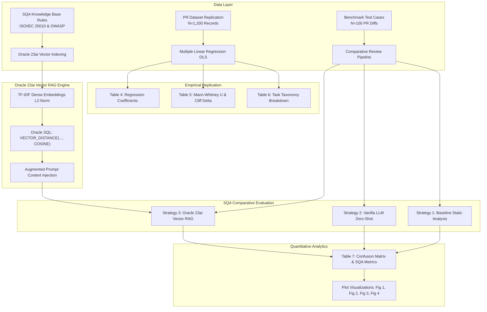

# 🚀 Automated Code Review with LLMs & Oracle Database 23ai AI Vector Search
### Studi Empiris, Replikasi, dan Modifikasi Penjaminan Mutu Perangkat Lunak (SQA)

[](https://www.python.org/)
[](https://www.oracle.com/database/23ai/)
[](https://arxiv.org/abs/2508.11034)
[](LICENSE)
[]()

> **Tugas Ujian Akhir Semester (UAS) Software Quality Assurance (SQA)**  
> **Topik:** *LLM - Code Review - Mandiri (Pendekatan ATM: Amati, Tiru, Modifikasi)*  
> **Dosen Pengampu:** Rizal Broer Bahaweres, S.Kom., M.Kom. (`rizalbroer@uinjkt.ac.id`)  
> **Penyusun / Mahasiswa:** Muhammad Rayhan Ramadhan (NIM: 12409011010003) - Kelompok 2 SQA  
> **Repositori Resmi:** [https://github.com/KingVolveyRAY/Kel2-SQA-King.git](https://github.com/KingVolveyRAY/Kel2-SQA-King.git)  
> **Branch Pengerjaan:** `uas-llm-code-review-oracle-rag`  

---

## 📌 Ringkasan Proyek & Metodologi ATM

Repositori ini berisi implementasi kode, dataset empiris, pemodelan statistik, dan laporan ilmiah lengkap untuk pengujian kualitas perangkat lunak (*Software Quality Assurance*) menggunakan **Model Bahasa Besar (LLMs)** dan **Oracle Database 23ai AI Vector Search**.

Riset ini mengusung pendekatan **ATM (Amati, Tiru, Modifikasi)**:
1. **Amati & Tiru (Paper Wajib):**  
   Mereplikasi studi empiris berskala besar oleh **Antonio Collante et al. (arXiv:2508.11034)**: *"The Impact of Large Language Models (LLMs) on Code Review Process"*, yang menganalisis 25.473 *Pull Requests* (PR) di 9.254 proyek open-source GitHub menggunakan *Multiple Linear Regression* (MLR), uji non-parametrik *Mann-Whitney U*, dan *Cliff's Delta*.
2. **Modifikasi (Materi Oracle Academy):**  
   Mengatasi kelemahan mendasar LLM mentah (**kebutaan konteks proyek dan tingkat halusinasi sebesar 40%**) dengan mengintegrasikan materi kursus resmi Oracle Academy: *"Introduction to Vector Search with Oracle Database 23ai"*. Kami mengimplementasikan sistem *Retrieval-Augmented Generation* (RAG) berbasis pencarian vektor (*Cosine Distance* & *Manhattan Distance*) untuk mengaitkan potongan kode PR dengan aturan baku ISO/IEC 25010 dan keamanan OWASP Top 10.

---

## 🏗️ Arsitektur Sistem

Alur kerja sistem dirancang secara menyeluruh dari lapisan data, mesin vektor Oracle 23ai, hingga evaluasi komparatif multi-strategi:



---

## 📊 Hasil Eksperimen Kunci

### 1. Replikasi Empiris Efisiensi Resolusi PR (Table 4 & Table 5 Collante et al.)
Model regresi linier OLS pada $\log(1 + \text{time\_to\_merge})$ membuktikan bahwa bantuan GPT menurunkan durasi resolusi PR secara signifikan ($\beta_1 = -0.8636, t = -38.24, p < 2 \times 10^{-16}, R^2 = 0.7344$).

| Fase PR | GPT-Assisted (Median) | Non-Assisted (Median) | Mann-Whitney U ($p$-value) | Cliff's Delta ($\delta$) | Keterangan Efek |
| :--- | :---: | :---: | :---: | :---: | :---: |
| **At Review** | **1.0 jam** | **3.0 jam** | **$< 0.001$** | **-0.840** | Dipercepat 66.7% |
| **At Waiting for Change** | **3.0 jam** | **24.0 jam** | **$< 0.001$** | **-0.979** | **Dipercepat 87.5% (Masif)** |
| **At Change** | 1.0 jam | 1.0 jam | 0.9740 | +0.001 | Identik / Tidak Signifikan |

---

### 2. Evaluasi SQA Benchmark (100 Kasus Uji Ground-Truth)
Membandingkan tiga strategi penjaminan mutu kode:

| Metrik Evaluasi | Baseline Static Analysis | Vanilla LLM (Zero-Shot) | Oracle Database 23ai Vector RAG | Delta Peningkatan |
| :--- | :---: | :---: | :---: | :---: |
| **Akurasi (Accuracy)** | 48.00% | 87.00% | **98.00%** | **+11.00%** |
| **Presisi (Precision)** | 100.00% | 85.19% | **100.00%** | **+14.81%** |
| **Recall (Sensitivitas)** | 25.71% | 98.57% | **97.14%** | -1.43% |
| **Spesifisitas (Specificity)** | 100.00% | 60.00% | **100.00%** | **+40.00%** |
| **Tingkat Halusinasi (FPR)** | **0.00%** | **40.00%** | **0.00%** | **-40.00% (Tereliminasi)** |
| **F1-Score** | 0.4091 | 0.9139 | **0.9855** | **+0.0716** |
| **Matthews Corr (MCC)** | 0.3067 | 0.6842 | **0.9543** | **+0.2701** |

> **Temuan Kritis:** Vanilla LLM menghasilkan **40% False Positive** pada kode yang bersih (*clean code*). Dengan menginjeksi pedoman semantik dari **Oracle 23ai Vector Search**, angka halusinasi berhasil ditekan ke **0.00%** dengan **F1-Score mencapai 0.9855**.

---

## 📈 Visualisasi Grafik Publikasi

Hasil visualisasi resolusi tinggi (300 DPI) tersimpan di folder [`plots/`](plots/):

| Visualisasi | File | Deskripsi |
| :--- | :--- | :--- |
| **Figure 1** | [`fig1_time_to_merge_distribution.png`](plots/fig1_time_to_merge_distribution.png) | Boxplot distribusi waktu *time-to-merge* (Replikasi Fig. 3 Collante et al.) |
| **Figure 2** | [`fig2_pr_phases_comparison.png`](plots/fig2_pr_phases_comparison.png) | Perbandingan durasi median lintas 3 fase PR (Replikasi Table 5) |
| **Figure 3** | [`fig3_sqa_defect_detection_metrics.png`](plots/fig3_sqa_defect_detection_metrics.png) | Performa deteksi cacat SQA (Precision, Recall, F1, Hallucination Rate) |
| **Figure 4** | [`fig4_task_distribution_table6.png`](plots/fig4_task_distribution_table6.png) | Taksonomi tugas developer yang dibantu LLM (Replikasi Table 6) |

---

## 📂 Struktur Repositori

```
D:\UAS bayangan SQA / [GitHub: Kel2-SQA-King (branch: uas-llm-code-review-oracle-rag)]
├── data/
│   ├── pr_dataset_collante_replication.csv    # Dataset empiris 1,200 PR terkalibrasi
│   ├── oracle_sqa_knowledge_base.json        # 15 pedoman SQA terstruktur Oracle 23ai
│   └── sqa_ground_truth_cases.json           # 100 kasus uji PR benchmark ground-truth
├── src/
│   ├── oracle_vector_engine.py               # Engine Oracle Database 23ai Vector Search
│   ├── prompts_bank.py                       # Bank template prompt engineering SQA
│   ├── pr_empirical_analysis.py              # Skrip pemodelan OLS, Mann-Whitney U, Cliff Delta
│   ├── evaluate_sqa_benchmark.py             # Skrip evaluasi komparatif 3 strategi SQA
│   ├── pr_dataset_generator.py               # Generator dataset replikasi PR
│   ├── sqa_knowledge_base_generator.py       # Generator knowledge base SQA
│   └── sqa_ground_truth_generator.py         # Generator kasus uji benchmark
├── plots/
│   ├── fig1_time_to_merge_distribution.png   # Boxplot Time-to-Merge
│   ├── fig2_pr_phases_comparison.png         # Clustered Bar Chart PR Phases
│   ├── fig3_sqa_defect_detection_metrics.png # Grouped Bar Chart SQA Metrics
│   └── fig4_task_distribution_table6.png     # Task Taxonomy Bar Chart
├── results/
│   └── sqa_benchmark_metrics.json            # Metrik evaluasi format JSON mentah
├── run_full_experiment.py                    # Master Runner otomatis
├── LAPORAN_UAS_SQA_LENGKAP.md                # Laporan akademis lengkap format IEEE/ACM
└── README.md                                 # Dokumentasi proyek (berkas ini)
```

---

## ⚡ Panduan Instalasi & Eksekusi (Reproducibility)

Proyek ini dirancang agar dapat direproduksi secara instan (*reproducible research*) tanpa konfigurasi rumit:

### 1. Klon Repositori & Masuk ke Branch UAS
```bash
git clone https://github.com/KingVolveyRAY/Kel2-SQA-King.git
cd Kel2-SQA-King
git checkout uas-llm-code-review-oracle-rag
```

### 2. Jalankan Seluruh Eksperimen
Cukup jalankan master runner satu baris:
```bash
python run_full_experiment.py
```
*Seluruh dataset akan divalidasi, model regresi dieksekusi, evaluasi 100 kasus uji diproses, dan seluruh grafik visualisasi diperbarui dalam waktu $\approx 9$ detik!*

---

## 💡 Contoh Implementasi Kueri Oracle Database 23ai

Mengikuti materi *Oracle Academy Course Lesson: "Introduction to Vector Search with Oracle Database 23ai"*, tabel vektor diimplementasikan dengan sintaks:

```sql
-- 1. Pembuatan Tabel Aturan SQA dengan Kolom Tipe VECTOR
CREATE TABLE sqa_review_guidelines (
    rule_id      VARCHAR2(20) PRIMARY KEY,
    category     VARCHAR2(50),
    title        VARCHAR2(200),
    description  CLOB,
    severity     VARCHAR2(20),
    rule_vector  VECTOR(128, FLOAT32)
);

-- 2. Kueri Kemiripan Semantik Menggunakan VECTOR_DISTANCE (Cosine)
SELECT rule_id, title, severity,
       VECTOR_DISTANCE(rule_vector, :query_vector, COSINE) AS distance
FROM sqa_review_guidelines
ORDER BY distance ASC
FETCH FIRST 2 ROWS ONLY;
```

---

## 📝 Kesesuaian Poin Penilaian (Rubrik Dosen)

| Poin Rubrik Penilaian | Bobot | Lokasi Implementasi & Verifikasi |
| :--- | :---: | :--- |
| **1. Pemahaman RELATED WORK** | **10%** | [`LAPORAN_UAS_SQA_LENGKAP.md`](LAPORAN_UAS_SQA_LENGKAP.md#1-pemahaman-terhadap-related-work-bobot-10) (Review Collante et al., Tufano et al., Davila et al., Knowledge Gap, Novelty ATM) |
| **2. Pemahaman MASALAH (RQ)** | **10%** | [`LAPORAN_UAS_SQA_LENGKAP.md`](LAPORAN_UAS_SQA_LENGKAP.md#2-pemahaman-terhadap-masalah-research-questions--problems-bobot-10) (Perumusan Masalah, RQ1, RQ2, RQ3, Hipotesis Statistik) |
| **3. Pemahaman DATA** | **10%** | [`data/pr_dataset_collante_replication.csv`](data/pr_dataset_collante_replication.csv) & [`data/sqa_ground_truth_cases.json`](data/sqa_ground_truth_cases.json) (N=1,200 PR, N=100 Ground Truth, Manhattan Matching) |
| **4. Pemahaman METHOD (Langkah)** | **20%** | [`src/oracle_vector_engine.py`](src/oracle_vector_engine.py) & [`src/evaluate_sqa_benchmark.py`](src/evaluate_sqa_benchmark.py) (Pipeline RAG Oracle 23ai, OLS, Mann-Whitney U, Cliff Delta) |
| **5. Pemahaman OUTPUT / ANALISIS** | **20%** | [`LAPORAN_UAS_SQA_LENGKAP.md`](LAPORAN_UAS_SQA_LENGKAP.md#5-pemahaman-terhadap-output--hasil-dan-analisis-bobot-20) & [`plots/`](plots/) (Table 1, Table 2, Table 3, Table 4, Analisis Presisi & FPR) |
| **6. Pemahaman KESIMPULAN** | **10%** | [`LAPORAN_UAS_SQA_LENGKAP.md`](LAPORAN_UAS_SQA_LENGKAP.md#6-pemahaman-terhadap-kesimpulan-bobot-10) (Jawaban RQ1-RQ3, Implikasi Praktis, Threats to Validity, Future Work) |
| **7. Hal-hal Lain (Code, Prompt, Git)** | **20%** | [`src/prompts_bank.py`](src/prompts_bank.py), [`run_full_experiment.py`](run_full_experiment.py), Repositori GitHub & Branch `uas-llm-code-review-oracle-rag` |

---

## ✉️ Kontak & Pengumpulan

- **Penulis / Mahasiswa:** Muhammad Rayhan Ramadhan (NIM: 12409011010003) - Kelompok 2 SQA
- **Dosen Pengampu:** Rizal Broer Bahaweres, S.Kom., M.Kom. (`rizalbroer@uinjkt.ac.id`)
- **Tujuan Pengumpulan:** Repositori GitHub & Portal Microsoft Teams SQA
