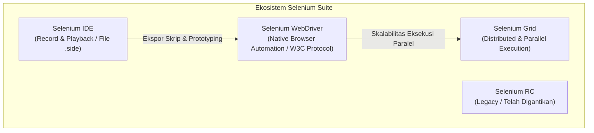
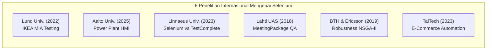
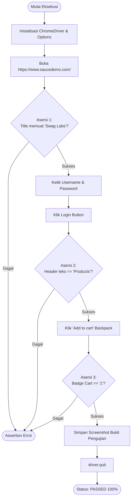
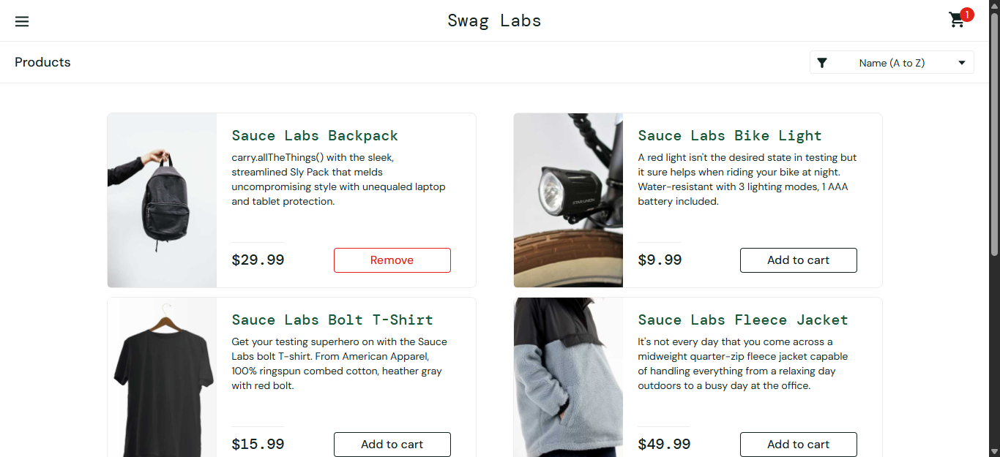

# 🌐 Automated Web Testing: Selenium IDE & Selenium WebDriver

Repositori branch **`Selenium-Testing`** ini memuat dokumentasi komprehensif, artefak proyek, dan kode implementasi pengujian otomatis antarmuka web (*automated web UI testing*) menggunakan ekosistem **Selenium** (baik aplikasi **Selenium IDE** berbasis *Record & Playback* maupun skrip pemrograman **Selenium WebDriver** berbasis Python). Proyek ini disusun untuk memenuhi tugas kelompok mata kuliah **Pengujian Perangkat Lunak (Software Quality Assurance / SQA)**.

---

## 👥 Informasi Kelompok & Mata Kuliah

### Anggota Kelompok 2
| No | Nama Mahasiswa | NIM | Peran / Kontribusi |
| :-: | :--- | :---: | :--- |
| 1 | **Muhammad Rayhan Ramadhan** | `12409011010003` | Analisis 5W+1H, Implementasi Skrip Python Selenium WebDriver, Penyusunan Laporan |
| 2 | **Arya Putra Fahreza** | `12409011010005` | Kajian Literatur Tesis/Skripsi Luar Negeri, Perekaman Skenario Selenium IDE |
| 3 | **Azka Azfar** | `12409011010008` | Verifikasi Pengujian, Validasi Asersi Selenese, Dokumentasi & Pengujian Regresi |

### Detail Akademik
| Komponen | Keterangan |
| :--- | :--- |
| **Mata Kuliah** | Pengujian Perangkat Lunak (*Software Quality Assurance*) |
| **Program Studi** | Teknik Informatika — UIN Syarif Hidayatullah Jakarta |
| **Dosen Pengampu** | Pak Broer |
| **Topik Tugas** | Eksplorasi & Implementasi Selenium Automation (5W+1H, Kajian Literatur Skripsi/Tesis Internasional, & Sample Pengujian Web) |
| **Repositori Utama** | [KingVolveyRAY/Kel2-SQA-King](https://github.com/KingVolveyRAY/Kel2-SQA-King) |
| **Target Branch** | `Selenium-Testing` |

---

## 📌 Daftar Isi
1. [Bab I: Analisis Konseptual Selenium (5W + 1H)](#-bab-i-analisis-konseptual-selenium-5w--1h)
2. [Bab II: Kajian Skripsi & Tesis Luar Negeri tentang Selenium](#-bab-ii-kajian-skripsi--tesis-luar-negeri-tentang-selenium)
3. [Bab III: Implementasi Pengujian Otomatis](#-bab-iii-implementasi-pengujian-otomatis)
   - [3.1 Skenario Pengujian](#31-skenario-pengujian-test-case-scenario)
   - [3.2 Implementasi Selenium IDE (.side)](#32-implementasi-selenium-ide-record--playback)
   - [3.3 Implementasi Selenium 4 WebDriver (Python)](#33-implementasi-selenium-4-webdriver-python)
   - [3.4 Hasil Eksekusi & Bukti Screenshot](#34-hasil-eksekusi--bukti-screenshot)
4. [Prasyarat & Cara Menjalankan Pengujian](#-prasyarat--cara-menjalankan-pengujian)
5. [Struktur Direktori Proyek](#-struktur-direktori-proyek)

---

## 📖 Bab I: Analisis Konseptual Selenium (5W + 1H)

Selenium merupakan kerangka kerja (*framework*) pengujian otomatis paling populer di industri rekayasa perangkat lunak modern untuk memvalidasi aplikasi berbasis web secara lintas peramban (*cross-browser*) dan lintas platform (*cross-platform*).



### Tabel Analisis 5W + 1H
| Dimensi | Pertanyaan Kritis | Penjelasan Lengkap & Arsitektur Teknis |
| :---: | :--- | :--- |
| **WHAT** | *Apa itu Selenium?* | **Selenium** adalah *framework open-source* portabel yang digunakan untuk mengotomatisasi interaksi pengguna pada peramban web (*web browser*). Selenium terdiri atas empat pilar utama: <br>1. **Selenium IDE**: Perangkat *Record & Playback* visual untuk membuat uji coba tanpa koding mendalam.<br>2. **Selenium RC (Selenium 1)**: Arsitektur awal yang menyuntikkan *JavaScript Core* ke dalam browser (kini telah usang).<br>3. **Selenium WebDriver (Selenium 2/3/4)**: Komponen inti modern yang berinteraksi langsung dengan peramban menggunakan protokol resmi **W3C WebDriver**.<br>4. **Selenium Grid**: Infrastruktur pendukung untuk mengeksekusi uji coba paralel di multi-mesin, multi-OS, dan multi-browser secara bersamaan.<br>Mendukung berbagai bahasa: **Python, Java, C#, JavaScript (Node.js), Ruby, dan Kotlin**. |
| **WHY** | *Mengapa Menggunakan Selenium?* | 1. **Bebas Biaya Lisensi (*Free & Open-Source*)**: Mengurangi beban biaya dibanding solusi *proprietary* seperti Micro Focus UFT atau TestComplete.<br>2. **Akurasi & Konsistensi**: Menghilangkan risiko kelalaian manusia (*human error*) pada pengujian fungsional yang berulang.<br>3. **Dukungan Lintas Browser & OS**: Kompatibel dengan Google Chrome, Mozilla Firefox, Microsoft Edge, dan Safari di lingkungan Windows, Linux, maupun macOS.<br>4. **Ekosistem & Komunitas Kuat**: Dokumentasi melimpah serta kemudahan integrasi dengan *test runner* (PyTest, JUnit, TestNG) dan *CI/CD pipeline* (GitHub Actions, Jenkins). |
| **WHO** | *Siapa Pencipta & Penggunanya?* | • **Pencipta**: Pertama kali digagas oleh **Jason Huggins** pada tahun 2004 di ThoughtWorks (awalnya bernama *JavaScriptTestRunner*). **Shinya Kasatani** mengembangkan **Selenium IDE** pada tahun 2006, sementara **Simon Stewart** merancang **WebDriver** pada tahun 2007 (digabung menjadi Selenium 2.0 pada 2011). Saat ini dikelola oleh *Software Freedom Conservancy*.<br>• **Pengguna**: *QA Automation Engineer*, *Software Tester*, Pengembang Web, serta akademisi/mahasiswa teknik informatika. |
| **WHEN** | *Kapan Diciptakan & Kapan Digunakan?* | • **Kronologi**: 2004 (Selenium Core) ➔ 2006 (Selenium IDE) ➔ 2011 (Selenium 2.0) ➔ 2016 (Selenium 3.0 W3C) ➔ 2021–sekarang (Selenium 4.0 dengan *bidirectional protocol* Chrome DevTools & aplikasi Electron IDE).<br>• **Waktu Implementasi**: Diterapkan pada siklus *Regression Testing* (fitur stabil yang diuji ulang), *Smoke & Sanity Testing* sebelum rilis ke server produksi, dan *End-to-End (E2E) Functional Testing* pada *flow* penting. |
| **WHERE** | *Di Mana Selenium Dijalankan?* | 1. **Mesin Pengembang Lokal (*Local Environment*)**: Dijalankan langsung melalui terminal pengembang atau Selenium IDE Desktop GUI.<br>2. **CLI Runner & Server CI/CD**: Berkas pengujian `.side` dapat dijalankan secara otomatis di *server pipeline* menggunakan `selenium-side-runner`.<br>3. **Cloud Testing Platforms**: Dijalankan pada infrastruktur pengujian berbasis cloud skala industri seperti Sauce Labs, BrowserStack, dan LambdaTest. |
| **HOW** | *Bagaimana Cara Kerjanya?* | **Selenium IDE** bekerja melalui tiga fase utama:<br>1. *Perekaman (Recording)*: Mendengarkan *event listener* DOM (klik, input ketik, navigasi).<br>2. *Konversi Perintah (Selenese)*: Memetakan aksi menjadi triplet instruksi: `Command` (aksi), `Target` (locator CSS/XPath/ID), dan `Value` (data masukan).<br>3. *Pemutaran & Validasi (Playback & Assertion)*: Mengirimkan instruksi kembali ke peramban dan memvalidasi kecocokan nilai harapan (*expected*) dengan nilai aktual (*actual*). |

---

## 📚 Bab II: Kajian Skripsi & Tesis Luar Negeri tentang Selenium

Berikut adalah telaah mendalam terhadap 6 skripsi (*Bachelor's Thesis*) dan tesis (*Master's Thesis*) dari universitas terkemuka di luar negeri (Swedia, Finlandia, dan Estonia) yang meneliti efektivitas, arsitektur, dan komparasi Selenium:



| No | Judul Skripsi / Tesis & Penulis | Universitas & Negara | Fokus Penelitian & Temuan Utama | Tautan Publikasi Resmi |
| :-: | :--- | :--- | :--- | :---: |
| **1** | **Automated Functional Tests for a Web Application**<br>*Johan Wulf (2022)* | **Lund University**, Swedia<br>*(Bachelor's Thesis in Computer Science)* | **Fokus**: Otomatisasi pengujian fungsional antarmuka web (UI) pada sistem internal IKEA (MIA). Meneliti seleksi elemen DOM, *Locators*, serta kombinasi *assertion library* untuk validasi fitur pembuatan slot waktu.<br>**Hasil**: Terbukti mempercepat verifikasi regresi pada setiap *push* repositori tim IKEA. | [Lund University Repository](https://lup.lub.lu.se/student-papers/record/9092785) |
| **2** | **Automated Web-Based Testing Framework for the Interface of a Power Plant Control**<br>*Duong Truong (2025)* | **Aalto University**, Finlandia<br>*(Master's Thesis in Electrical & Automation)* | **Fokus**: Merancang pengujian otomatis untuk *Human-Machine Interface* (HMI) sistem kendali pembangkit listrik (*safety-critical*). Membandingkan kemampuan sinkronisasi dinamis Selenium vs Playwright.<br>**Hasil**: Selenium terbukti matang dalam dukungan lintas peramban industri, namun memerlukan manajemen *explicit wait* yang disiplin pada antarmuka berkepatan tinggi. | [Aalto University Aaltodoc](https://aaltodoc.aalto.fi/bitstreams/05ae4267-c6b8-439d-859d-6f20cb0455c6/download) |
| **3** | **Choosing the Right Automated UI Testing Tool: A Comparative Study of Selenium and TestComplete**<br>*Sofia Tibell & Muskan Kholi (2023)* | **Linnaeus University (Linnéuniversitetet)**, Swedia<br>*(Bachelor's Thesis in Software Tech)* | **Fokus**: Studi komparatif empiris antara alat *open-source* (Selenium) dan alat berbayar (*TestComplete*) berdasarkan kecepatan eksekusi, *maintainability*, dan kurva pembelajaran.<br>**Hasil**: Selenium unggul mutlak dalam fleksibilitas integrasi kode dan efisiensi biaya operasional jangka panjang (*zero licensing fee*). | [DiVA Portal Swedia](https://www.diva-portal.org/smash/record.jsf?pid=diva2:1764099) |
| **4** | **Implementing Test Automation with Selenium WebDriver: Case Study MeetingPackage.com**<br>*Quan Dao (2018)* | **Lahti University of Applied Sciences (LAMK)**, Finlandia<br>*(Bachelor's Thesis in Business IT)* | **Fokus**: Mengukur penghematan waktu pengujian (*time efficiency*) pada tim pengembang Agile/Scrum di perusahaan MeetingPackage.com menggunakan pendekatan *Design Science Research*.<br>**Hasil**: Terjadi pemangkasan waktu pengujian QA regresi secara signifikan dari jam menjadi hitungan menit. | [Theseus.fi Finlandia](https://www.theseus.fi/handle/10024/152509) |
| **5** | **A Search-Based Approach for Robustness Testing of Web Applications**<br>*Master's Thesis Team (2019)* | **Blekinge Institute of Technology (BTH)**, Swedia<br>*(Bekerja sama dengan Ericsson)* | **Fokus**: Pengujian ketahanan (*robustness testing*) web dengan memadukan Selenium WebDriver dan algoritma evolusioner genetik **NSGA-II** (*Search-Based Software Testing*).<br>**Hasil**: Berhasil mendeteksi cacat tersembunyi (*fault revelation*) dengan panjang rangkaian uji yang optimal pada sistem skala korporasi Ericsson. | [DiVA Portal BTH](https://www.diva-portal.org/smash/get/diva2:1336628/FULLTEXT02) |
| **6** | **Comparative Analysis of Selecting a Test Automation Framework for an E-Commerce Website**<br>*K. H. Brahmbhatt (2023)* | **Tallinn University of Technology (TalTech)**, Estonia<br>*(Master's Thesis)* | **Fokus**: Evaluasi pemilihan framework otomatisasi pengujian untuk alur transaksi *e-commerce* modern (pencarian produk, keranjang belanja, *checkout*).<br>**Hasil**: Merumuskan matriks keputusan adopsi alat berdasarkan stabilitas eksekusi lintas peramban, struktur tim, dan fleksibilitas *CI/CD*. | [TalTech Digital Library](https://digikogu.taltech.ee/) |

---

## 🛠️ Bab III: Implementasi Pengujian Otomatis

Implementasi pengujian dilakukan pada situs *benchmark* standar industri QA: **[SauceDemo Swag Labs](https://www.saucedemo.com/)**.

### 3.1 Skenario Pengujian (*Test Case Scenario*)
* **Kode Test Case**: `TC_01_Login_dan_Tambah_Keranjang`
* **Base URL**: `https://www.saucedemo.com/`
* **Objektif**:
  1. Melakukan autentikasi menggunakan akun standar pengguna yang valid.
  2. Memverifikasi bahwa peramban berhasil diarahkan ke katalog produk (*Products*).
  3. Memilih dan memasukkan produk `Sauce Labs Backpack` ke keranjang belanja.
  4. Memverifikasi bahwa indikator *badge* keranjang belanja bertambah menjadi `1`.
  5. Melakukan simulasi alur *checkout* hingga selesai (*finish*).
* **Data Masukan (*Test Data*)**:
  * Username: `standard_user`
  * Password: `secret_sauce`
  * Customer Info: First Name = `demo`, Last Name = `sauce`, Postal Code = `123456`

---

### 3.2 Implementasi Selenium IDE (*Record & Playback*)
Proyek disimpan dalam format resmi `.side` ([Tugas_SQA_Selenium.side](file:///d:/Selenium-testing/Tugas_SQA_Selenium.side)). Berkas ini berisi tabel perintah instruksi *Selenese* yang dieksekusi secara berurutan:

| No | Command (Perintah) | Target (Elemen UI) | Value (Nilai Masukan) | Deskripsi Langkah |
| :-: | :--- | :--- | :--- | :--- |
| **1** | `open` | `https://www.saucedemo.com` | - | Membuka URL aplikasi target |
| **2** | `click` | `css=[data-test="username"]` | - | Fokus pada input username |
| **3** | `type` | `css=[data-test="username"]` | `standard_user` | Mengetik nama pengguna |
| **4** | `click` | `css=[data-test="password"]` | - | Fokus pada input kata sandi |
| **5** | `type` | `css=[data-test="password"]` | `secret_sauce` | Mengetik kata sandi |
| **6** | `click` | `css=[data-test="login-button"]` | - | Menekan tombol Login |
| **7** | `click` | `css=[data-test="add-to-cart-sauce-labs-backpack"]` | - | Menambahkan produk tas ke keranjang |
| **8** | `click` | `css=[data-test="shopping-cart-badge"]` | - | Membuka keranjang belanja |
| **9** | `click` | `css=[data-test="checkout"]` | - | Masuk ke formulir checkout |
| **10** | `click` | `css=[data-test="firstName"]` | - | Fokus kolom nama depan |
| **11** | `type` | `css=[data-test="firstName"]` | `demo` | Mengisi nama depan |
| **12** | `click` | `css=[data-test="lastName"]` | - | Fokus kolom nama belakang |
| **13** | `type` | `css=[data-test="lastName"]` | `sauce` | Mengisi nama belakang |
| **14** | `click` | `css=[data-test="postalCode"]` | - | Fokus kolom kode pos |
| **15** | `type` | `css=[data-test="postalCode"]` | `123456` | Mengisi kode pos |
| **16** | `click` | `css=[data-test="continue"]` | - | Melanjutkan ke review transaksi |
| **17** | `click` | `css=[data-test="finish"]` | - | Konfirmasi final pesanan selesai |

---

### 3.3 Implementasi Selenium 4 WebDriver (Python)
Selain menggunakan Selenium IDE, pengujian juga diimplementasikan dalam bentuk kode skrip Python otomatis ([test_selenium_demo.py](file:///d:/Selenium-testing/test_selenium_demo.py)).

Skrip ini dilengkapi dengan:
1. **Explicit Wait (`WebDriverWait` & `EC.visibility_of_element_located`)**: Menjamin elemen siap diinteraksikan sebelum aksi klik/ketik, menghindari *NoSuchElementException*.
2. **Multiple Assertions**:
   - `assert "Swag Labs" in driver.title` (Validasi judul halaman)
   - `assert teks_header == "Products"` (Validasi keberhasilan login)
   - `assert jumlah_item == "1"` (Validasi fungsionalitas keranjang)
3. **Automated Visual Capture**: Mengambil tangkapan layar otomatis (`hasil_uji_selenium.png`) saat pengujian berhasil.



#### Cuplikan Kode Utama:
```python
# Inisialisasi WebDriver
options = webdriver.ChromeOptions()
options.add_argument("--start-maximized")
driver = webdriver.Chrome(options=options)
wait = WebDriverWait(driver, 10)

try:
    # 1. Buka Halaman
    driver.get("https://www.saucedemo.com/")
    assert "Swag Labs" in driver.title, "Judul halaman tidak sesuai!"

    # 2. Input Kredensial & Klik Login
    wait.until(EC.visibility_of_element_located((By.ID, "user-name"))).send_keys("standard_user")
    driver.find_element(By.ID, "password").send_keys("secret_sauce")
    driver.find_element(By.ID, "login-button").click()

    # 3. Asersi Katalog Produk
    header = wait.until(EC.visibility_of_element_located((By.CLASS_NAME, "title"))).text
    assert header == "Products", "Gagal masuk ke katalog produk!"

    # 4. Tambah ke Keranjang Belanja
    driver.find_element(By.ID, "add-to-cart-sauce-labs-backpack").click()

    # 5. Asersi Badge Keranjang
    badge = wait.until(EC.visibility_of_element_located((By.CLASS_NAME, "shopping_cart_badge"))).text
    assert badge == "1", "Jumlah item di keranjang tidak sesuai!"

    # 6. Screenshot Otomatis
    driver.save_screenshot("hasil_uji_selenium.png")
finally:
    driver.quit()
```

---

### 3.4 Hasil Eksekusi & Bukti Screenshot

#### 1. Log Eksekusi Terminal (Python WebDriver)
```text
============================================================
MEMULAI PENGUJIAN OTOMATIS SELENIUM WEBDRIVER
============================================================
[STEP 1] Membuka halaman web: https://www.saucedemo.com/
         Judul halaman terdeteksi: 'Swag Labs'
[STEP 2] Mengisi form Username dan Password...
[STEP 3] Mengklik tombol Login...
[STEP 4] Verifikasi halaman setelah login -> Header: 'Products'
[STEP 5] Menambahkan produk 'Sauce Labs Backpack' ke keranjang...
[STEP 6] Jumlah item di keranjang saat ini: 1 item
[STEP 7] Bukti pengujian berhasil disimpan ke: hasil_uji_selenium.png
------------------------------------------------------------
STATUS AKHIR: SEMUA TEST CASE BERHASIL (PASSED 100%)
------------------------------------------------------------
[INFO] Menutup sesi browser Selenium WebDriver...
```

#### 2. Bukti Tangkapan Layar Otomatis (*Visual Proof*)
Berikut adalah hasil tangkapan layar otomatis yang dihasilkan oleh skrip saat pengujian berhasil mencapai tahap validasi produk di keranjang belanja:



---

## 🚀 Prasyarat & Cara Menjalankan Pengujian

### 1. Prasyarat Sistem
* **Python**: Versi 3.10 atau yang lebih baru (`python --version`)
* **Google Chrome**: Versi terbaru
* **Selenium IDE**: Ekstensi browser Chrome/Firefox atau aplikasi *Selenium IDE Desktop Client*

### 2. Cara Menjalankan Skrip Python (Selenium WebDriver)
1. **Clone Repositori dan Pindah ke Branch `Selenium-Testing`**:
   ```bash
   git clone -b Selenium-Testing https://github.com/KingVolveyRAY/Kel2-SQA-King.git
   cd Kel2-SQA-King
   ```
2. **Instal Dependensi**:
   ```bash
   pip install -r requirements.txt
   ```
3. **Jalankan Skrip Pengujian**:
   ```bash
   python test_selenium_demo.py
   ```
   *(Browser Chrome akan otomatis terbuka, menjalankan pengujian langkah demi langkah, memvalidasi asersi, menyimpan screenshot `hasil_uji_selenium.png`, dan menutup sesi secara otomatis).*

### 3. Cara Membuka & Menjalankan Proyek di Selenium IDE
1. Buka aplikasi **Selenium IDE** (atau buka ekstensi Selenium IDE di Chrome).
2. Pilih opsi **Open an existing project**.
3. Pilih file **`Tugas_SQA_Selenium.side`**.
4. Klik tombol ikon **Play / Run Current Test** (segitiga di bagian atas).
5. Selenium IDE akan otomatis mereplikasi aksi pengujian dan menampilkan status sukses (*Passed* - warna hijau) untuk setiap perintah Selenese.

---

## 📁 Struktur Direktori Proyek

```text
Kel2-SQA-King (branch: Selenium-Testing)/
├── .gitignore                                 # Konfigurasi file pengabaian Git
├── requirements.txt                           # Dependensi pustaka Python (selenium>=4.0.0)
├── README.md                                  # Dokumentasi komprehensif tugas & pengujian
├── Laporan Tugas SQA kelompok 2_Selenium.pdf  # Berkas laporan resmi tugas SQA kelompok 2
├── Tugas_SQA_Selenium.side                    # Proyek pengujian Selenium IDE (Record & Playback)
├── test_selenium_demo.py                      # Skrip pengujian otomatis Python Selenium 4 WebDriver
└── hasil_uji_selenium.png                     # Bukti tangkapan layar hasil eksekusi pengujian
```

---

## 📄 Dokumen Laporan Resmi
Dokumen laporan lengkap dalam format PDF telah disertakan langsung di dalam branch ini:
- 📑 **[Laporan Tugas SQA kelompok 2_Selenium.pdf](Laporan%20Tugas%20SQA%20kelompok%202_Selenium.pdf)**

---
*Dibuat dengan dedikasi oleh **Kelompok 2** — Pengujian Perangkat Lunak, Teknik Informatika UIN Syarif Hidayatullah Jakarta.*
